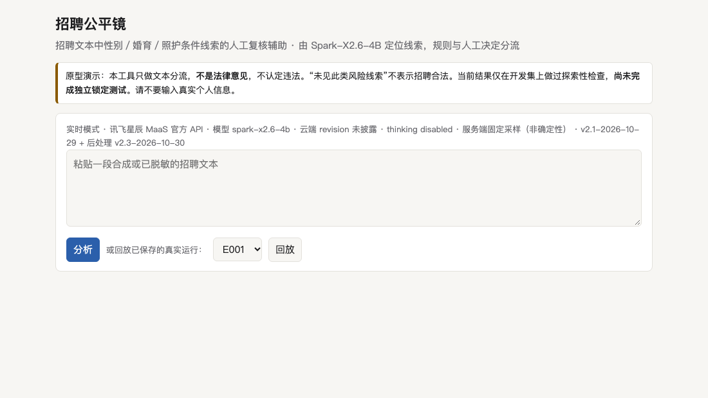
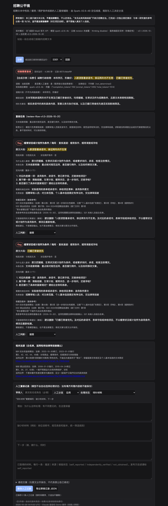
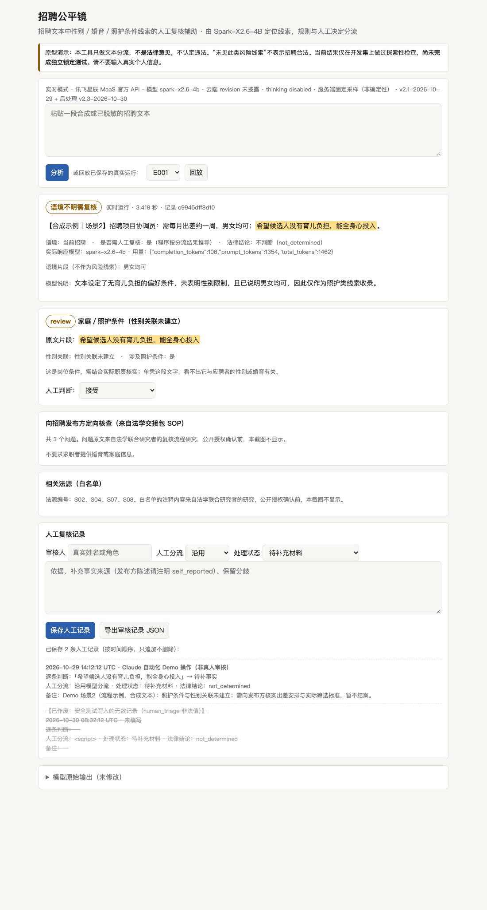
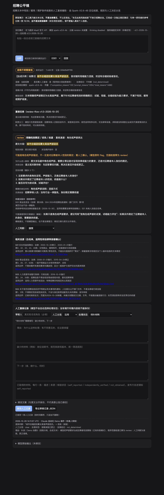

# 招聘公平镜 · Recruitment Fairness Lens

**招聘公平镜帮招聘信息审核人员找出中文招聘文本中与性别、婚育、照护有关的条件线索，并给出原文证据和待核实的问题，最后由人来判断。**

> HER Hack-Astron #7 · Spark-X2.6 Open Source AI for Good Challenge · 方向：**Gender equality（性别平等）**
> 本工具只做文本分流，**不认定企业违法，不自动举报，不做企业排名，不替代法律判断**。“未见此类风险线索”不表示招聘合法。

---

## 1. 为谁、解决什么问题
- **目标用户**：招聘信息发布平台的审核人员、公共就业服务机构工作人员。他们本来就要审核招聘信息，也能要求发布方补充岗位材料。
- **问题**：
  - 招聘文本中常出现性别或婚育限制，比如“男性优先”“宝妈勿扰”“已婚已育者优先”“承诺两年内不生育”，而且常被“男女不限”之类的表述掩盖。
  - 也有大量看起来相关、实际上正常的写法，比如出差、夜班、搬运能力要求，“欢迎女性申请”，新闻引用，已删除的旧条件，剧中角色、声部。关键词规则很难区分。
  - 至于“没有家庭／育儿负担”这类照护条件，不能直接等同于针对女性。
- **公益价值**：帮助审核人员更快找到需要人工核实的原文，并知道还缺哪些事实；判断留给人来做，工具不推断任何人的性别或婚育情况。

## 2. 工作流
```
招聘文本输入 → Spark-X2.6-4B 分析 → 原文证据定位（程序逐字校验） → 风险分流（flag / review / unknown / clear）
            → 人工审核（逐条接受 / 修改 / 拒绝） → 导出 JSON 审核记录（含原始模型输出与人工修改）
```
| 分流 | 含义 | 不表示 |
|---|---|---|
| flag 明确需要复核 | 当前招聘文本中有明确的性别或婚育限定、优先、劝退 | 违法已成立 |
| review 语境不明需复核 | 有语境暗示，或照护条件与岗位的关系需要核实 | 歧视的可能性高 |
| unknown 暂无法判断 | 缺少关键事实，例如自称“国家规定例外”但没有条款和岗位信息 | 风险低 |
| clear 未见此类线索 | 所给文字中没有看到本产品关注的线索 | 招聘合法 |

## 3. Spark-X2.6-4B 做什么
模型读入招聘文本，输出 JSON：
- `scope`：判断文本属于哪种语境（当前招聘、引用或历史、培训、信息不足）。
- `findings`：逐条列出线索，每条包含原文片段、线索类型（明示性别、婚育条件、照护条件、语境暗示、声称例外）、与性别关联的程度、是否属于照护条件。
- `missing_facts` 和 `rationale`：还需核实的事实，以及一句说明。

**模型不决定分流结果，也不给出法律结论。** 程序负责以下几件事：
- 校验每个引用是否是原文的连续片段；
- 按线索类型映射到分流类别（`rfl/contract_v2.py`）；
- 推导是否需要人工复核；
- 显示白名单法源编号。

## 4. 两种推理方式（两者不等价）
| | 官方 MaaS API（Demo 使用） | 本地开源权重 |
|---|---|---|
| 模型 | 讯飞星辰 MaaS `spark-x2.6-4b`（每次响应都核对 `model` 字段） | Hugging Face `XHToken/Spark-X2.6-4B` @ `d1b5f26071101c27fcd07728e7a7770e428281f4` |
| 版本 / 精度 / 硬件 | **均未公开**；我们不声称它与左侧的开源 revision 相同 | bf16，无量化；参考硬件 Apple M3 16 GB（MPS） |
| 解码 | `thinking.type=disabled`；采样由服务端固定为 T=1、top_p=0.95，**结果不确定** | `enable_thinking=False`，贪心解码，结果确定 |
| 输出上限 | `max_completion_tokens=640` | `max_new_tokens=640` |
| 实测延迟（86 条开发样本） | 中位数 4.1 s，P95 7.2 s | 中位数 22.4 s，P95 43.7 s |

## 5. 安装与运行
完整说明见 [REPRODUCE.md](REPRODUCE.md)。
```bash
python3 -m unittest discover -s tests        # 39 个工程测试，只需 Python 3.12+ 标准库
```
**A. 官方 MaaS 实时推理**（需要自己的讯飞 MaaS API Key）
```bash
mkdir -p ~/.config/rfl
# 先把 Key 复制到剪贴板（macOS），或改用环境变量 XFYUN_API_KEY
pbpaste > ~/.config/rfl/xfyun_api_key && chmod 600 ~/.config/rfl/xfyun_api_key
python3 mvp/server.py --provider xfyun_maas   # 打开 http://127.0.0.1:8765
```
**API Key 安全说明**：
- Key 只由本地服务端从环境变量或权限为 600 的文件读取，不会发给浏览器，也不会写入日志或导出文件。
- 服务只监听 127.0.0.1，并拒绝跨站请求和非 JSON 请求。
- 默认每个进程最多调用 60 次，可用 `XFYUN_MAX_CALLS` 调整。
- 请勿把 Key 提交到仓库。

**B. 本地开源权重推理**（约 9 GB 显存或统一内存）
```bash
hf download XHToken/Spark-X2.6-4B --revision d1b5f26071101c27fcd07728e7a7770e428281f4 --local-dir ../models/Spark-X2.6-4B --exclude "images/*"
python3 -m venv .venv && .venv/bin/pip install -r requirements.txt     # transformers==4.57.1（模型官方 README 指定版本）
.venv/bin/python mvp/server.py --provider local_transformers
```
**C. 只读回放**（不调用任何模型，页面会标明“回放”）
```bash
python3 mvp/server.py --replay outputs_v3/maas_v2.1_plus_pp2.3_dev86/records.jsonl --replay-raw outputs_v3/maas/dev86_v2.1_raw/raw.jsonl
```
回放展示的是此前真实 MaaS 运行保存下来的输出（70 条公开开发样本），**不是实时推理**。

## 6. 演示（真实运行截图）
三个场景都是 2026-10-30 用冻结版本（Prompt v2.1 + 后处理 v2.3）真实调用 MaaS `spark-x2.6-4b` 的结果，输入均为合成文本。

关于截图，请注意两点：
- 截图中的“人工”操作是 AI 开发工具执行的**自动化流程演示**，审核人一栏写的是“非真人审核”，**不是正式的人工法律审核**。
- 划删除线的记录是准备 Demo 时自动化脚本挂错的条目，已标为作废，原始记录保留未删，见 `docs_v4/demo/CORRECTIONS.md`。

截图中的法源说明和 SOP 核查问题来自法学联合研究者（608），已获她授权公开。

| 首页 | 场景 1：明确的婚育限制 |
|---|---|
|  |  |

- **场景 1**：输入“入职须签署承诺书，保证两年内不生育；已婚已育者优先”，模型返回两条婚育线索，都判为 **flag**，耗时 4.4 s。演示中两条都选“接受”，转法律审阅，法律结论栏为“不判断”。
- **场景 2**：输入“希望候选人没有育儿负担，能全身心投入”，判为 **review**，性别关联“未建立”，附有向发布方核查的问题；出差要求没有触发警报。演示中选“待补事实”。**这次的问题**：模型没有填写待补充事实。
- **场景 3（已知失败）**：输入“城市合唱团招募女高音声部团员”，模型**误判**为应聘者性别限定；程序的范围检查把它降为 review，提示“可能是声部描述”。演示中判为误报并改为 clear。

| 场景 2：照护条件的不确定性 | 场景 3：声部误报与人工纠正 |
|---|---|
|  |  |

## 7. 已实现的功能
- 两种推理方式：官方 MaaS 和本地 Transformers。还有只读回放模式。
- 输出校验：逐字核对引用是否为原文连续片段；检查枚举值和必填键；输出中出现“违法”“合法”这类法律结论用语时，判为无效。
- 后处理 v2.3，每次修复都记录在案，原始输出保留：
  - 近似键名修复
  - 字符串外重复逗号修复
  - 引号内的法律用语豁免
  - 角色或声部范围检查（flag 降为 review，**绝不**降为 clear）
- 无效输出一律交人工处理，**不会被当成 clear**。可以手动点“重新请求”，两次记录都会保存。
- **人工复核流程 review-flow v1.0**（按法学联合研究者 608 提出的人工复核产品要求实现，见 [docs_v5/REVIEW_REQUIREMENTS_MATRIX.md](docs_v5/REVIEW_REQUIREMENTS_MATRIX.md)）：
  - 每条线索一张复核卡：本条任务（flag 侧重规范适用、例外和改写；review 先回答事实问题；unknown 列出缺失材料）、入队原因、最多 3 个定向问题、需要的岗位材料、负责核查的角色、条款级依据参考（标明法规层级，适用性待法律审阅者确认）、文案模板。
  - 处理状态：待补材料、语境误报已更正、已形成修改文案、风险线索获补强、待核例外适用、保留不确定，另有两个保留状态。每个状态都有结案条件，**没有登记已取得的材料就无法选择收口类状态**。证据要标注是发布方自述还是已核验。
  - 修改文案与原文分开保存，可以对修改稿再检测。审核人必填。审核记录只追加不删除，可以标记作废。导出 JSON 包含原文、原始输出、复核卡和全部人工记录。
  - 2026-10-31 用单独编写的合成数据实际演示了一次完整流程：`docs_v5/demo/review_flow_*`。
- 冻结与审计：
  - `docs_v3/FREEZE_v2.1_pp2.3.json` 记录冻结时的哈希；
  - `docs_v4/FREEZE_ADDENDA.json` 登记此后仅涉及界面和安全的改动；
  - `scripts/run_locked_test.py` 是一次性锁定测试脚本：拒绝带标签的输入，运行后封存预测结果。

## 8. 结果、证据强度与已知失败

### 8.1 独立锁定测试（2026-10-31，已完成）
**这些数字是与一名法学本科研究者（608）的参考分类的一致率，部分支持字段由 GPT 辅助整理。它们不是法律准确率，也不是律师认证或多专家金标准。**

| 与参考分类一致 | 全部 30 条 | 预先标记的争议 12 条 | 其余 18 条 | 输出有效 |
|---|---|---|---|---|
| Spark-X2.6-4B 冻结系统（官方 MaaS API） | **15/30** | **0/12** | **15/18** | 28/30 |
| 基线 A（原始关键词规则） | 10/30 | 4/12 | 6/18 | 30/30 |
| 基线 B（修订规则） | 13/30 | 3/12 | 10/18 | 30/30 |

- **2 条网络失败**（没有模型输出）留在分母中，没有重跑。
- **flag 和 review 存在重要分歧**：参考为 review 的 7 条，系统没有一条判为 review；系统判为 review 的 6 条，参考也都不是 review。
- 0/12 不能作为认定模型法律判断错误的依据，但也不能全部归因于参考标注：冻结规则把明确线索一律映射为 flag，系统无法表达“文字明确，但仍需先核实”这样的判断，这是系统自身的局限。
- 流程：评分协议预注册 → 只收到 case_id 和原文 → 运行一次 → 封存预测 → 校验后才打开参考分类。测试之后没有修改系统重测。
- 测试案例、逐条参考标签和争议记录**未公开**。详见 [docs_v5/LOCKED_TEST_RESULT_SUMMARY.md](docs_v5/LOCKED_TEST_RESULT_SUMMARY.md)。

### 8.2 开发集（探索性，不是法律识别准确率，也不是独立测试成绩）

内部开发集共 86 条合成文本：
- 50 条原始案例。标签是法学联合研究者授权下的 **AI 辅助研究意见**，没有逐条人工确认。
- 16 条法学研究提供的回归样例。**未授权公开，所以本仓库不包含**。
- 20 条工程探针。

这些样本都参与过 Prompt 设计，所以分数偏乐观。

| 开发集 86 条（内部） | 本地 v2.1 | 本地 + 后处理 v2.3 | MaaS v2.1 原始 | MaaS + 后处理 v2.3 |
|---|---|---|---|---|
| 四分类与研究标签一致 | 79/86 | 81/86 | 68/86 | 78/86 |
| 输出通过校验 | 84/86 | 86/86 | 73/86 | 85/86 |

- 下面三类错误在四种配置下都是 0：review 被判成 flag（0/8）、unknown 被强行定类（0/5）、照护条件被推断为性别（0/7）。
- 把引用、历史或否定语境误报为风险：本地 0/18，MaaS 1/18。
- **复现限制**：研究标签没有公开，所以上表无法用本仓库独立复算。本仓库能复现的是推理、校验、分流、网页和回放。
- **已知失败**：
  - 角色或声部误报：开发集中 4/4，靠程序降级兜底，模型本身没有改善。
  - “欢迎女性申请”会被误报。
  - 模型偶尔不填写待补充事实。
  - MaaS 随机采样容易导致 JSON 格式错误：原始输出 13/86 无效，修复后剩 1/86。
- **尚未完成**：真实用户研究。
- **原型局限**：没有多人协作和权限；联系发布方需要线下进行；证据只能以文字登记；文案建议是模板；冻结的 source_ids 只细化到法律文件这一级（条款级参考只在复核卡里提供，不参与评分）。

## 9. 法律工作的三个层次（需要区分清楚）
1. **已经完成**：法学联合研究者整理了法律依据和法源索引，识别了争议点，提出了标注规则、人工复核流程和照护责任专题意见，并与项目负责人讨论确认了主要规则，例如“照护责任不等于女性”“角色或声部不等于应聘者性别限定”。
2. **AI 辅助、尚未逐条人工核实**：50 条研究标签是在她授权下由 AI 初审形成的，不是法律专家金标准。
3. **独立锁定测试**：已完成一次，608 独立编写 30 条合成案例并给出参考分类（GPT 辅助生成公告、整理支持字段；单一本科研究者参考，没有多专家一致，也没有律师审定）。

## 10. 公开范围说明
法学联合研究者（608）**已授权公开**以下内容，本仓库均已包含：
- 冻结 Prompt v2.1 原文，与冻结记录逐字节一致
- 法律标注规则与分流原则
- 人工复核 SOP 的核查问题
- 已核实的法源白名单及适用边界说明

**尚未公开**的内容：
- 50 条 AI 辅助研究标签
- 16 条回归样例原文
- 法学研究意见和专题备忘
- 本轮锁定测试的案例、逐条参考标签和争议记录（测试已完成，是否公开由团队另行决定）

仓库中的原始日志是**过滤版**：删除了回归样例所在的行，替换了本机路径，其余内容逐字保留。详见 [RELEASE_NOTE.txt](RELEASE_NOTE.txt) 和 [docs_v4/PUBLIC_PERMISSIONS.md](docs_v4/PUBLIC_PERMISSIONS.md)。

## 11. 贡献者与 AI 辅助开发披露
- **项目负责人（GitHub：[yangmengze608-afk](https://github.com/yangmengze608-afk)）**：负责产品、AI 技术、工程验收、实验设计与最终提交。
- **法学联合研究者（公开署名：608）**：负责法律依据与法源核实、争议识别、标注规则与分流原则设计、人工复核 SOP、案例分析、法律边界与产品设计讨论，以及独立锁定测试的出题与人工首轮判断。
- **AI 辅助工具**：
  - Claude Code（Anthropic）编写并运行了工程代码、评估脚本、网页和文档，也执行了 Demo 截图中的流程操作。
  - ChatGPT 用于独立审阅，并辅助检索整理法学研究资料、完成标注初审。
  - AI 工具不是团队成员。

## 12. 目录
```
rfl/            契约与校验（contract_v2）、Prompt（prompt_v2_1）、Provider（providers）、后处理（postprocess_v2_3）
scripts/        运行（run_provider / run_spark_v2）、评估（evaluate_v2）、冻结、锁定测试、封存校验、评分
mvp/            单页网页（index.html）与本地服务端（server.py）
baseline/       基线 A（原始关键词规则）、基线 B（修订规则 rules_v2）
data/ data_v2/  合成开发样本输入（已过滤未授权样例）、法源白名单（已授权）
outputs*/       各轮真实模型原始输出（过滤版：删除了未授权的回归样例行）
docs*/          各阶段报告、冻结记录、Demo 截图与导出记录
```
